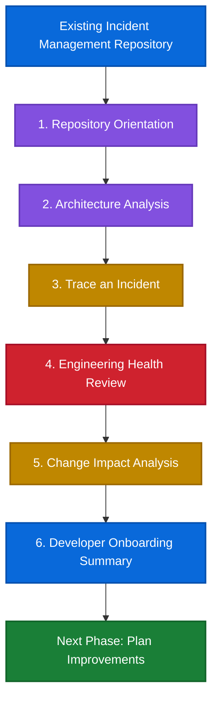
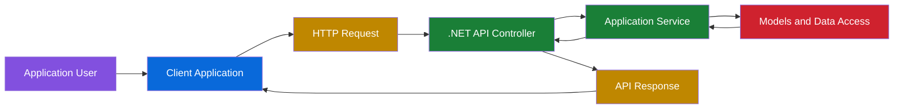
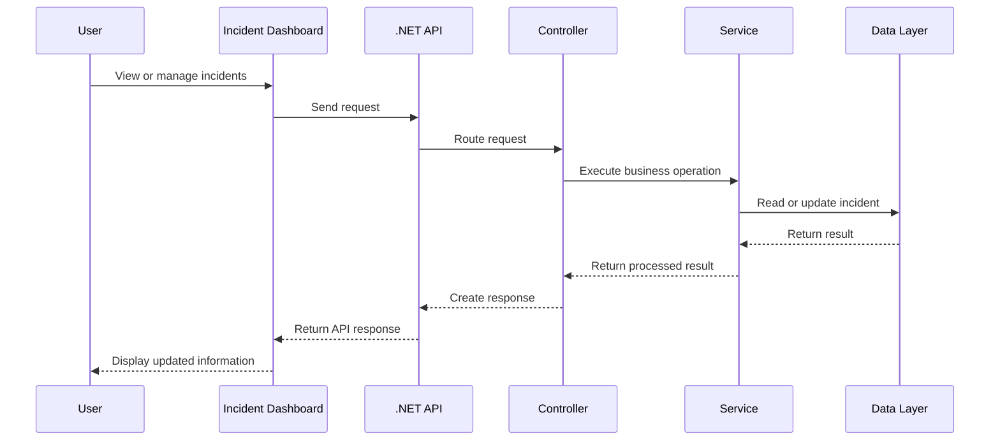
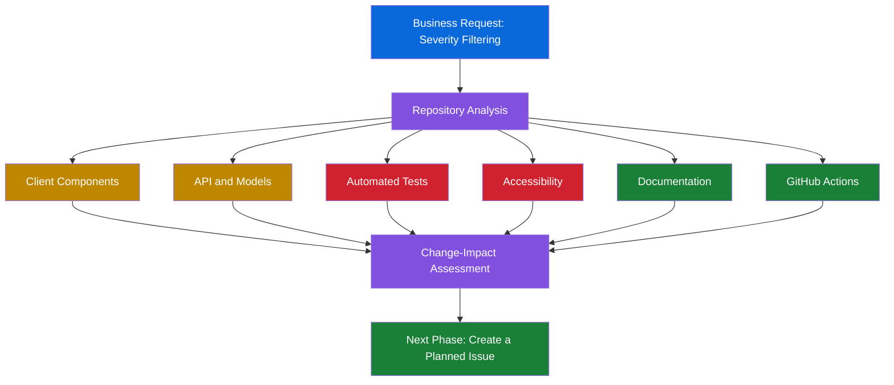
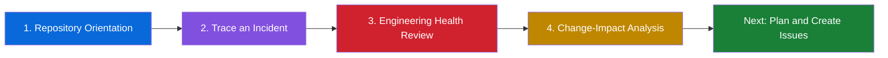

# Analyze an Existing Repository with GitHub Copilot

## Objective

Before asking the GitHub Copilot coding agent to modify the Incident Management application, use Copilot to understand the existing repository.

This phase answers five questions:

```text
What is here?
      ↓
How does it work?
      ↓
How does an incident move through the application?
      ↓
How healthy is the repository?
      ↓
What would be affected by a change?
```

---

# Analysis Flow



---

# Demo Overview

| Demo | Question | Output |
|---:|---|---|
| 1 | What is in this repository? | Repository map |
| 2 | How do the components work together? | Architecture overview |
| 3 | How does an incident move through the application? | Feature trace |
| 4 | How healthy is the repository? | Engineering assessment |
| 5 | What would be affected by a new feature? | Change-impact analysis |
| 6 | What should a new developer understand? | Onboarding summary |

---

# Demo 1: Repository Orientation

## Scenario

A development team has inherited the Incident Management repository.

Before making changes, the team needs to understand:

- What the application does
- Which technologies it uses
- How the repository is organized
- Where the client and API are located
- How the application is built and deployed

## Prompt

Copy and paste this prompt into GitHub Copilot:

```text
Analyze this repository as if you are onboarding a developer who has never seen it before.

Identify:

1. What the application does.
2. The technologies and frameworks used.
3. The major directories and their responsibilities.
4. The client application.
5. The backend API.
6. The main application entry points.
7. Tests and testing frameworks.
8. GitHub Actions workflows.
9. CI/CD configuration.
10. Existing documentation.

Create a concise repository map.

For every conclusion:

- Reference the supporting file or directory.
- Clearly separate confirmed facts from assumptions.
- Explain anything that could not be confirmed.

Do not modify files.
Do not create Issues.
Do not create a branch.
Do not create a Pull Request.
```

## Expected outcome

```text
Incident Management Application
             |
     +-------+-------+
     |               |
   Client          .NET API
     |               |
 UI components    Controllers
                     |
                  Services
                     |
               Models and Data
             |
      GitHub Workflows
             |
   Build, Scan, and Deploy
```

## Review checklist

- [ ] Application purpose is correctly identified
- [ ] Major technologies are listed
- [ ] Client and API locations are correct
- [ ] Entry points are identified
- [ ] Test projects are identified
- [ ] GitHub Actions workflows are listed
- [ ] Observations reference actual files
- [ ] Assumptions are clearly labeled
- [ ] No repository files were changed

## Key takeaway

> GitHub Copilot can first act as a repository investigator rather than immediately acting as a code author.

---

# Demo 2: Architecture Analysis

## Scenario

The repository structure is now clear, but the team still needs to understand how the application components work together.

## Prompt

```text
Analyze the architecture of the Incident Management application.

Explain:

1. The major application components.
2. The responsibilities of the client application.
3. The responsibilities of the .NET API.
4. The API controllers.
5. The services and business logic.
6. The models.
7. The data-access components.
8. Configuration files.
9. External dependencies.
10. Build and deployment components.

Describe the major request and data flow through the application.

For every major conclusion:

- Reference the relevant repository files.
- Include only relationships supported by repository evidence.
- Clearly label assumptions or unresolved areas.

Do not modify files.
Do not create Issues.
Do not create a branch.
Do not create a Pull Request.
```

## Expected architecture



## Review checklist

- [ ] Client responsibilities are accurate
- [ ] API responsibilities are accurate
- [ ] Controllers and services are identified
- [ ] Data access is supported by repository evidence
- [ ] External services are not invented
- [ ] Request and response flows are logical
- [ ] Every major conclusion references repository files

## Key takeaway

> Repository orientation explains what exists. Architecture analysis explains how the parts work together.

---

# Demo 3: Trace the Incident Lifecycle

## Scenario

The team now understands the architecture at a high level.

Next, trace a relatable business scenario through the application:

> What happens when a user views or manages an incident?

## Prompt

```text
Trace the lifecycle of an incident through this repository.

Start from the user interaction in the client and follow the flow through the backend.

Identify:

1. The UI components involved.
2. Client-side state or logic.
3. API calls.
4. API routes.
5. Controllers.
6. Request and response models.
7. Business logic.
8. Services.
9. Data access.
10. Input validation.
11. Error handling.
12. The response returned to the client.

Present the sequence in execution order.

For every stage:

- Reference the relevant file.
- Explain the responsibility of that stage.
- Clearly identify anything that could not be confirmed.

Do not modify files.
Do not create Issues.
Do not create a branch.
Do not create a Pull Request.
```

## Expected feature trace



## Review checklist

- [ ] The correct UI component is identified
- [ ] The API route is supported by the code
- [ ] The correct controller is referenced
- [ ] Business logic is traced accurately
- [ ] Models are identified
- [ ] Validation is included where present
- [ ] Error handling is described
- [ ] The response path back to the user is explained
- [ ] Unsupported assumptions are identified

## Key takeaway

> This demonstration shows that Copilot can reason across multiple files to understand a complete business flow.

---

# Demo 4: Engineering Health Review

## Scenario

The application is understood.

Before deciding what to improve, review the repository's engineering health.

## Prompt

```text
Review this repository as a senior software engineer.

Identify evidence-based observations in these areas:

- Potential bugs
- Missing automated tests
- Error handling
- Maintainability
- Code duplication
- Naming consistency
- Accessibility
- Documentation gaps
- Input validation
- Security areas requiring further review
- CI/CD gaps

For every observation, provide:

1. What you found.
2. Evidence from the repository.
3. The relevant files or directories.
4. Why the observation matters.
5. The potential impact.
6. Confidence: High, Medium, or Low.
7. Whether the observation is confirmed or requires further investigation.

Do not propose implementation details yet.
Do not modify code.
Do not create Issues.
Do not create a branch.
Do not create a Pull Request.

Clearly separate:

- Confirmed findings
- Potential concerns
- Recommendations for further investigation
```

## Expected assessment structure

```text
Repository Health
       |
       +-- Functionality
       |
       +-- Testing
       |
       +-- Maintainability
       |
       +-- Accessibility
       |
       +-- Security Review Areas
       |
       +-- Documentation
       |
       +-- CI/CD
```

## Review checklist

- [ ] Every observation includes evidence
- [ ] Confirmed problems are separated from concerns
- [ ] Confidence is stated
- [ ] Findings are not duplicated
- [ ] No unsupported vulnerabilities are claimed
- [ ] Missing tests are linked to actual behavior
- [ ] CI/CD observations reference workflow files
- [ ] No changes were made

## Key takeaway

> A repository observation is not automatically a backlog item. Human review determines whether the observation is valid, valuable, and actionable.

---

# Demo 5: Change-Impact Analysis

## Scenario

Operations users want to filter incidents by severity.

Before implementing the feature, analyze what would be affected.

## Proposed feature

```text
Add severity filtering with these options:

- All
- Critical
- High
- Medium
- Low
```

## Prompt

```text
Do not implement anything.

Analyze the impact of adding severity filtering to the Incident Management application.

Users should be able to filter incidents by:

- All
- Critical
- High
- Medium
- Low

Determine:

1. Which existing components would likely be involved.
2. Which files would likely require modification.
3. Whether API changes appear necessary.
4. Whether client-only filtering is possible.
5. Whether severity values already exist in a shared model or constant.
6. Which existing tests are relevant.
7. Which new tests would be required.
8. Potential edge cases.
9. Potential accessibility considerations.
10. Potential implementation risks.
11. Which documentation would need updating.
12. Which GitHub Actions checks would validate the change.

Reference repository evidence for every conclusion.

Where multiple implementation approaches are possible:

- Explain the alternatives.
- Describe the trade-offs.
- Do not select one unless repository evidence strongly favors it.

Do not modify files.
Do not create Issues.
Do not create a branch.
Do not create a Pull Request.
```

## Expected impact view



## Review checklist

- [ ] Likely client changes are identified
- [ ] API impact is supported by evidence
- [ ] Client-only filtering is considered
- [ ] Tests are identified
- [ ] Edge cases are included
- [ ] Empty-result behavior is considered
- [ ] Accessibility impact is considered
- [ ] Documentation impact is identified
- [ ] Validation workflows are identified
- [ ] No implementation was performed

## Key takeaway

> Change-impact analysis connects repository understanding to development planning without prematurely modifying the application.

---

# Demo 6: Developer Onboarding Summary

## Scenario

The detailed analysis is complete.

Now ask Copilot to compress the findings into a concise explanation for a developer joining the project.

## Prompt

```text
Based only on repository evidence, explain the Incident Management application to a developer joining the project today.

Cover:

1. What the application does.
2. How the client and API fit together.
3. The most important directories.
4. The main application entry points.
5. Where a developer should start reading the code.
6. How to restore and build the application.
7. How to run tests.
8. How Pull Requests are validated.
9. How security scanning works.
10. How accepted changes are deployed.

Keep the explanation concise and practical.

Reference the relevant files and directories.

End with a section titled:

Five Things to Understand Before Changing This Repository

Do not modify files.
Do not create Issues.
Do not create a branch.
Do not create a Pull Request.
```

## Expected outcome

```text
Repository Knowledge
        ↓
Concise Onboarding Summary
        ↓
Developer Understands
        |
        +-- Application purpose
        +-- Architecture
        +-- Important files
        +-- Build and test
        +-- Validation and deployment
```

## Key takeaway

> Copilot can move from deep repository analysis to concise knowledge transfer.

---

# Recommended Live-Demo Sequence

For a focused session, use these four core demonstrations:



Use the remaining demos when additional depth is needed:

- **Architecture Analysis** for technical audiences
- **Developer Onboarding Summary** for knowledge-transfer scenarios

---

# Complete UNDERSTAND Phase

```text
EXISTING REPOSITORY
        |
        v
+----------------------------+
| REPOSITORY ORIENTATION     |
| What is here?              |
+-------------+--------------+
              |
              v
+----------------------------+
| ARCHITECTURE ANALYSIS      |
| How do the parts connect?  |
+-------------+--------------+
              |
              v
+----------------------------+
| FEATURE TRACE              |
| How does an incident flow? |
+-------------+--------------+
              |
              v
+----------------------------+
| ENGINEERING HEALTH         |
| What deserves attention?   |
+-------------+--------------+
              |
              v
+----------------------------+
| CHANGE-IMPACT ANALYSIS     |
| What would a change affect?|
+-------------+--------------+
              |
              v
+----------------------------+
| ONBOARDING SUMMARY         |
| What should developers     |
| understand?                |
+-------------+--------------+
              |
              v
             PLAN
```

---

# Prompt Quick Reference

## Repository orientation

```text
Analyze this repository as if you are onboarding a developer who has never seen it before.

Identify the application purpose, technologies, major directories, client, API, entry points, tests, GitHub Actions, CI/CD, and documentation.

Reference supporting files.

Separate confirmed facts from assumptions.

Do not modify anything.
```

## Architecture analysis

```text
Analyze the architecture of this repository.

Explain the client, API, controllers, services, models, data access, configuration, dependencies, and deployment components.

Describe the major request and data flow.

Reference repository evidence.

Do not modify anything.
```

## Incident lifecycle

```text
Trace the lifecycle of an incident through this repository.

Start with the client interaction and follow the flow through API calls, controllers, services, models, data access, validation, error handling, and the response.

Reference files for every stage.

Do not modify anything.
```

## Engineering health

```text
Review this repository as a senior software engineer.

Identify evidence-based observations related to bugs, tests, error handling, maintainability, accessibility, documentation, validation, security-review areas, and CI/CD.

Separate confirmed findings from potential concerns.

Do not modify anything.
```

## Change impact

```text
Do not implement anything.

Analyze the impact of adding severity filtering with All, Critical, High, Medium, and Low.

Identify affected files, implementation alternatives, required tests, edge cases, risks, accessibility considerations, documentation updates, and validation workflows.

Reference repository evidence.
```

## Developer onboarding

```text
Explain this repository to a developer joining the project today.

Cover the application purpose, architecture, important directories, entry points, build, tests, PR validation, security scanning, and deployment.

End with five things a developer should understand before changing the repository.

Do not modify anything.
```

---

# Transition to the Next Phase

The UNDERSTAND phase produces:

- Repository map
- Architecture overview
- Incident lifecycle
- Engineering health assessment
- Change-impact analysis
- Developer onboarding summary

The next phase is:

```text
UNDERSTAND
     ↓
Review Findings
     ↓
PLAN
     ↓
Prioritize Improvements
     ↓
CREATE ISSUES
```

> **Understanding explains what exists. Planning decides which opportunities should become work.**
