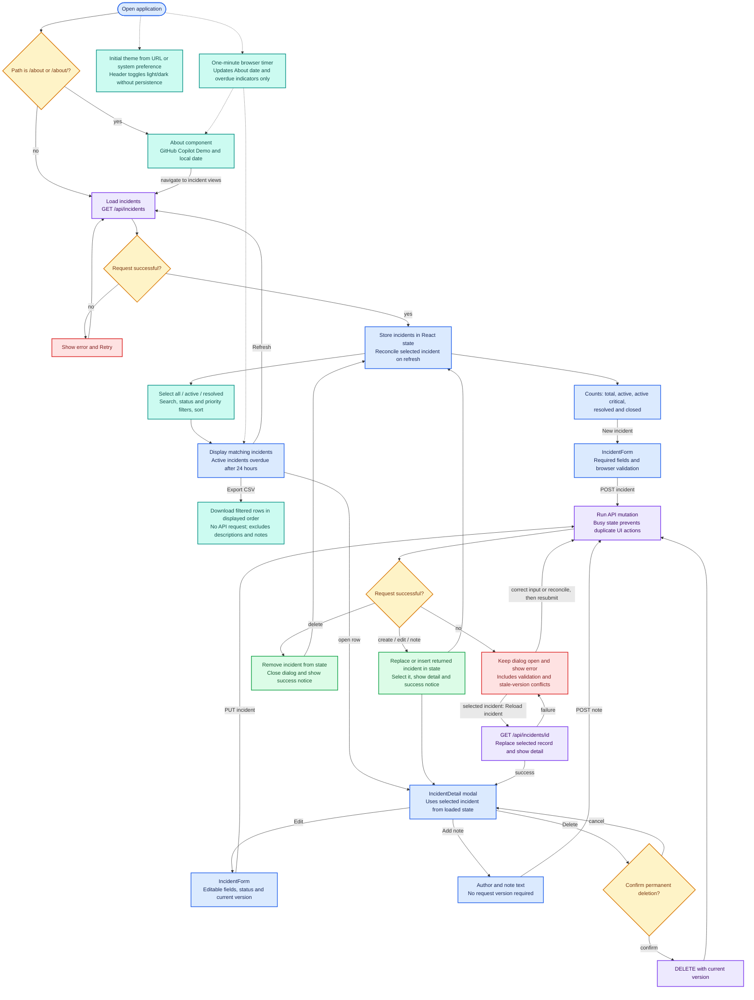
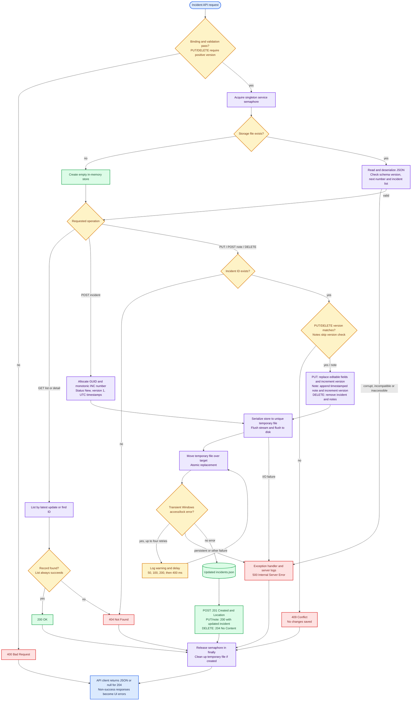

# IncidentDesk application flow

IncidentDesk is a local incident-management application built with React 19,
Vite 7, and ASP.NET Core on .NET 10. The diagrams below describe the implemented
flow, including browser-only features, API validation, and JSON-file persistence.

**Color key:** blue = browser/UI, purple = API, amber = decisions/validation,
green = successful results/storage, red = errors, teal = browser-only features.

## 1. Application architecture

```mermaid
flowchart LR
    User(["User"])

    subgraph Browser["Browser: React application"]
        Boot["index.html<br/>Initial theme and main.jsx"]
        App["App.jsx<br/>Navigation, state, loading and mutations"]
        UI["Dashboard and incident table<br/>Forms, details and confirmation dialogs"]
        Local["About date and theme toggle<br/>Search, filters, sort and overdue indicators"]
        CSV["incidentCsv.js<br/>Download matching, sorted rows"]
        Client["incidentService.js<br/>fetch /api/incidents"]
        Boot --> App
        App <--> UI
        App --> Local
        App --> CSV
        App <--> Client
    end

    subgraph Hosting["HTTP hosting"]
        Vite["Development: Vite at 127.0.0.1:5173<br/>Proxy /api to localhost:5051"]
        Static["Optional built UI in wwwroot<br/>ASP.NET static files and index.html fallback"]
    end

    subgraph Backend["ASP.NET Core API"]
        Program["Program.cs<br/>Controllers, JSON string enums and exception handler"]
        Controller["IncidentsController<br/>CRUD and note endpoints"]
        Validation["Request models<br/>Trimmed text, required fields, enums and versions"]
        Service["Singleton IIncidentService<br/>JsonIncidentService"]
        Health["GET /api/health<br/>Process health only"]
        Program --> Controller
        Controller --> Validation --> Service
        Program --> Health
    end

    Store[("Data/incidents.json<br/>Schema version, next number, incidents and notes")]
    User --> Boot
    User --> UI
    Vite -.->|"serves frontend"| Boot
    Static -.->|"serves frontend"| Boot
    Client <-->|"development API requests/responses"| Vite
    Vite <--> Program
    Client <-->|"same-origin API when hosted by .NET"| Program
    Service <-->|"reread each operation; persist mutations"| Store

    classDef ui fill:#dbeafe,stroke:#2563eb,color:#172554,stroke-width:2px;
    classDef api fill:#ede9fe,stroke:#7c3aed,color:#3b0764,stroke-width:2px;
    classDef decision fill:#fef3c7,stroke:#d97706,color:#78350f,stroke-width:2px;
    classDef success fill:#dcfce7,stroke:#16a34a,color:#14532d,stroke-width:2px;
    classDef local fill:#ccfbf1,stroke:#0d9488,color:#134e4a,stroke-width:2px;
    class User,Boot,App,UI,Vite,Static ui;
    class Client,Program,Controller,Service api;
    class Validation decision;
    class Store,Health success;
    class Local,CSV local;
```

The storage path defaults to `Data/incidents.json` relative to the API content
root; `Storage__FilePath` can override it. There is no database, authentication,
or authorization. Use one API process per file: the semaphore does not coordinate
multiple processes. The health endpoint does not read or validate the store.

## 2. Navigation and user actions

The dashboard uses all loaded incidents, not just filtered rows. Active means
`New`, `InProgress`, or `OnHold`; `Resolved` and `Closed` are inactive. List
loading occurs on entering an incident page and on explicit refresh, not on the
one-minute timer. CSV export is disabled while loading, during a mutation, or
when no rows match; it uses quoted UTF-8 CSV with a BOM and formula protection.

## 3. API, concurrency, and persistence

Edits may choose any supported status; there is no enforced sequential status
workflow. Saving as `Resolved` or `Closed` preserves an existing `resolvedAt`
or sets it to the current UTC time. Saving an active status clears `resolvedAt`.
Adding notes updates `updatedAt` and `version`, but does not change status.
Stale edits/deletes fail rather than overwrite newer data.

## Source map

| Flow | Implementation |
| --- | --- |
| Boot, theme, and development proxy | `client/index.html`, `client/src/main.jsx`, `client/vite.config.js` |
| Navigation, dashboard, filtering, refresh, and mutations | `client/src/App.jsx` |
| Forms, details, dialogs, and About | `client/src/components/` |
| Status definitions and overdue calculation | `client/src/models/incident.js` |
| HTTP requests and CSV download | `client/src/services/incidentService.js`, `client/src/services/incidentCsv.js` |
| API setup, optional frontend hosting, and health | `IncidentManagement.Api/Program.cs` |
| Routes and HTTP responses | `IncidentManagement.Api/Controllers/IncidentsController.cs` |
| Request validation and storage entities | `IncidentManagement.Api/Models/Requests.cs`, `IncidentManagement.Api/Models/Incident.cs` |
| CRUD, versions, file locking, and atomic writes | `IncidentManagement.Api/Services/JsonIncidentService.cs` |
